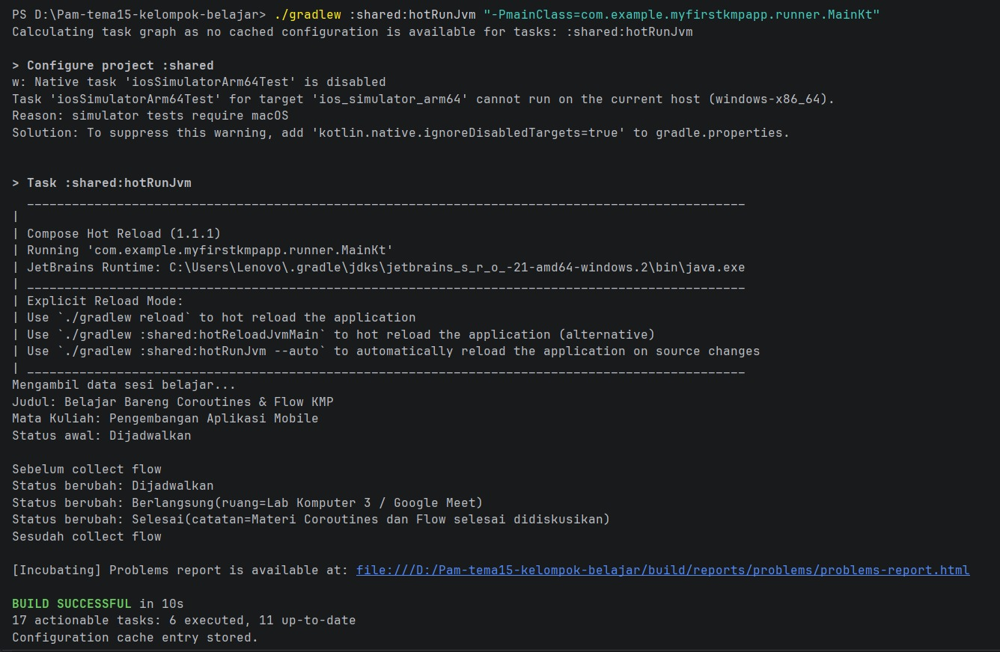
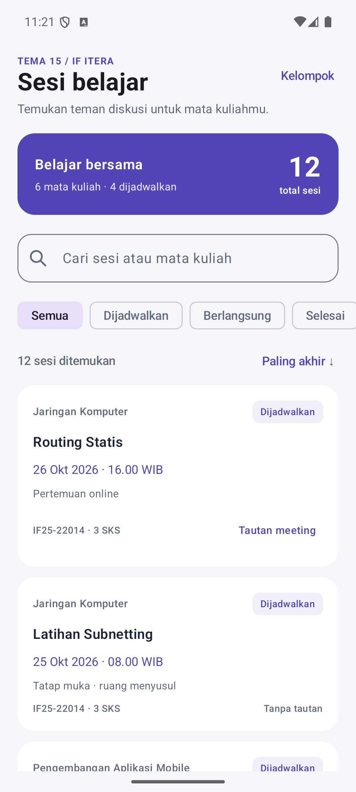
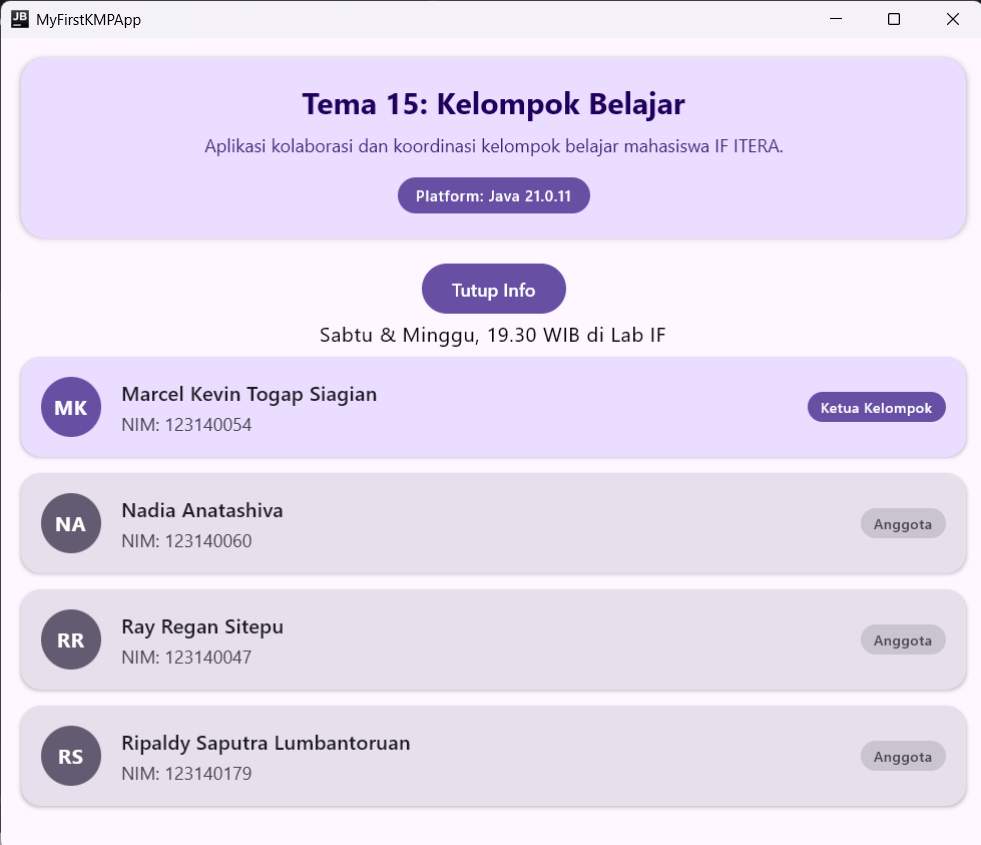
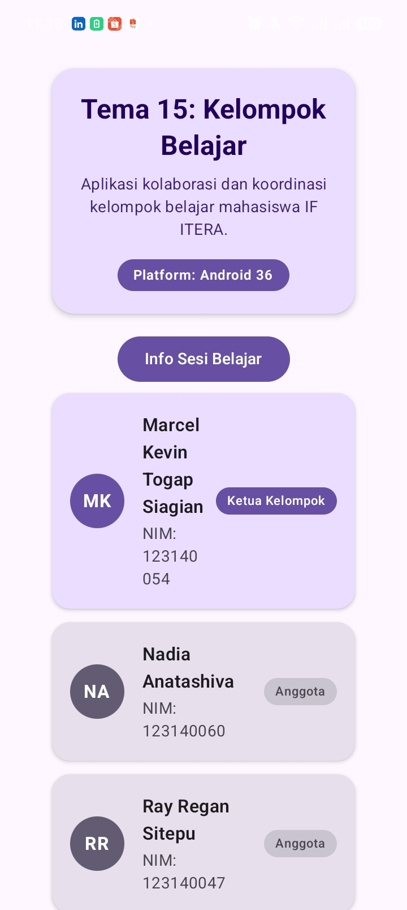

# PAM — Tema 15: Kelompok Belajar
**IF25-22017 Pengembangan Aplikasi Mobile**  
Program Studi Teknik Informatika — Institut Teknologi Sumatera (ITERA)

---

## Anggota Kelompok

| No | NIM | Nama | Peran |
|:---:|:---:|:---|:---:|
| 1 | 123140054 | Marcel Kevin Togap Siagian | Ketua Kelompok |
| 2 | 123140060 | Nadia Anatashiva | Anggota |
| 3 | 123140047 | Ray Regan Sitepu | Anggota |
| 4 | 123140179 | Ripaldy Saputra Lumbantoruan | Anggota |

---

## Informasi Proyek
- **Nomor Tema**: 15
- **Topik Tema**: Kelompok Belajar
- **Fitur Platform Terintegrasi**: Notifikasi
- **Teknologi**: Kotlin Multiplatform (KMP) & Compose Multiplatform
- **Target Platform**: Android, Desktop (JVM), iOS

---

## Branching
Branch `main` digunakan sebagai *base template* proyek. Setiap penambahan fitur dan tugas mingguan dikerjakan pada branch terpisah:
- `main`: Base template awal proyek KMP.
- `Tugas<minggu>`: Branch pengerjaan checkpoint/fitur berkala sebelum di-merge via Pull Request (contoh: `Tugas1`).

---

## Dokumentasi Checkpoint 1

Pada tahap **Checkpoint 1**, kelompok telah berhasil menyelesaikan target utama pertemuan pertama:

1. **Setup Lingkungan & KMP**:
    - Berhasil menginisialisasi proyek berbasis **Compose Multiplatform** yang dapat berjalan pada target **Desktop (JVM)** dan **Android**.
    - Menerapkan mekanisme **`expect` / `actual`** pada `Platform.kt` untuk menampilkan nama dan versi runtime platform aktif secara dinamis (`getPlatform().name`) pada header aplikasi.

2. **Tampilan Identitas & Tema**:
    - Menampilkan identitas **Tema 15: Kelompok Belajar** beserta deskripsinya pada header utama.
    - Menampilkan kartu profil seluruh anggota kelompok (`AnggotaCard`) yang memuat Nama, NIM, inisial avatar dinamis, dan penanda peran (Ketua/Anggota).

3. **Fitur Bonus Interaktivitas State & Animasi**:
    - Menerapkan **State Management** menggunakan `remember { mutableStateOf(false) }` untuk mengontrol tombol interaktif buka/tutup (*toggle*) informasi jadwal sesi belajar kelompok.
    - Mengintegrasikan komponen **`AnimatedVisibility`** agar kemunculan jadwal belajar memiliki efek transisi animasi yang halus dan responsif.

---

## Dokumentasi Checkpoint 2: Model Data, Coroutines, dan Flow

Checkpoint 2 menerapkan model data dan sumber data dummy untuk **Tema 15: Kelompok Belajar**. Pengambilan satu sesi dilakukan melalui fungsi `suspend`, sedangkan perubahan status sesi dikirim melalui `Flow`. Bukti berjalan diperoleh dengan mengeksekusi runner konsol.

### Rangkuman Pengerjaan

Seluruh kode Checkpoint 2 berada di `shared/src/commonMain/kotlin/com/example/myfirstkmpapp/` agar logika dapat digunakan bersama oleh target KMP.

| Bagian | Implementasi | Hasil pengerjaan |
|:---|:---|:---|
| Entitas utama | [`model/SesiBelajar.kt`](shared/src/commonMain/kotlin/com/example/myfirstkmpapp/model/SesiBelajar.kt) | `data class SesiBelajar` menyimpan ID, judul, mata kuliah, waktu mulai, tautan pertemuan, dan status sesi. |
| Entitas pendukung | [`model/MataKuliah.kt`](shared/src/commonMain/kotlin/com/example/myfirstkmpapp/model/MataKuliah.kt) | `data class MataKuliah` menyimpan kode, nama, dan jumlah SKS. |
| Status sesi | [`model/StatusSesiBelajar.kt`](shared/src/commonMain/kotlin/com/example/myfirstkmpapp/model/StatusSesiBelajar.kt) | `sealed class StatusSesiBelajar` membatasi status menjadi `Dijadwalkan`, `Berlangsung(ruang)`, dan `Selesai(catatan)`. |
| Kontrak sumber data | [`data/Sumber.kt`](shared/src/commonMain/kotlin/com/example/myfirstkmpapp/data/Sumber.kt) | Interface generik `Sumber<T>` menyediakan `suspend fun ambil(id: Int): T` dan `fun pantau(id: Int): Flow<T>`. |
| Sumber data dummy | [`data/SumberSesiBelajarDummy.kt`](shared/src/commonMain/kotlin/com/example/myfirstkmpapp/data/SumberSesiBelajarDummy.kt) | Mengimplementasikan `Sumber<SesiBelajar>`, menyediakan tiga sesi contoh, serta menyimulasikan pengambilan data dan perubahan status menggunakan `delay` dan `emit`. |
| Runner konsol | [`runner/Main.kt`](shared/src/commonMain/kotlin/com/example/myfirstkmpapp/runner/Main.kt) | Menggunakan `runBlocking` untuk menjalankan `ambil(1)` dan mengoleksi `pantau(1)` dengan `collect`, lalu mencetak hasilnya ke konsol. |

Properti `tautanMeeting: String?` menandai bahwa tautan pertemuan boleh kosong (`null`). Model juga menyediakan extension function `SesiBelajar.ringkas()` dan `StatusSesiBelajar.label()` untuk menghasilkan ringkasan dan label status.

Pada sumber data dummy, `ambil(id)` menunggu 1.000 ms menggunakan `delay` sebelum mengembalikan sesi. Jika ID tidak ditemukan, sumber mengembalikan sesi belajar mandiri dengan ID tersebut. `pantau(id)` mengambil data dasar, memancarkan status `Dijadwalkan`, menunggu 1.500 ms, memancarkan `Berlangsung`, lalu menunggu 2.000 ms sebelum memancarkan `Selesai`. Setiap perubahan menggunakan `copy()` untuk membuat nilai sesi baru.

Flow yang dibangun dengan `flow { ... }` bersifat *cold*: pengambilan data dan pemancaran status baru dimulai saat `collect` dipanggil. Pada runner, `Sesudah collect flow` tercetak setelah ketiga status selesai diterima. Pengujian Checkpoint 2 ini memverifikasi logika model dan sumber data melalui konsol.

### Pembagian Tugas Anggota Kelompok

Urutan pengerjaan: **Marcel (Model) → Nadia (Data Source) → Ripaldy (Runner) → Ray (README)**.

| Urutan | Nama | NIM | Fokus | Tugas Checkpoint 2 |
|:---:|:---|:---:|:---|:---|
| 1 | Marcel Kevin Togap Siagian | 123140054 | Model | Menyiapkan `SesiBelajar`, `MataKuliah`, dan `StatusSesiBelajar`, termasuk tipe nullable dan extension function model. |
| 2 | Nadia Anatashiva | 123140060 | Data Source | Menyiapkan kontrak `Sumber<T>` dan `SumberSesiBelajarDummy` dengan fungsi `suspend`, `delay`, serta Flow perubahan status. |
| 3 | Ripaldy Saputra Lumbantoruan | 123140179 | Runner | Menyiapkan `runner/Main.kt` untuk menjalankan pengambilan sesi dan mencetak perubahan status dari Flow. |
| 4 | Ray Regan Sitepu | 123140047 | Dokumentasi README | Menulis rangkuman Checkpoint 2, memasukkan log keluaran konsol hasil eksekusi runner, serta mencantumkan tabel pembagian tugas. |

### Cara Menjalankan Runner Checkpoint 2

Runner konsol memiliki entry point `com.example.myfirstkmpapp.runner.MainKt`, berbeda dari entry point aplikasi Desktop. Untuk menjalankannya secara mandiri di Windows, siapkan JDK dan distribusi Kotlin CLI dengan `java` serta `kotlinc` tersedia di `PATH`, dan pastikan folder `lib` Kotlin memuat `kotlinx-coroutines-core-jvm.jar`.

Jalankan perintah PowerShell berikut dari direktori proyek yang berisi `settings.gradle.kts` dan `README.md`. Perintah ini mengompilasi berkas model, data, dan runner; hasil kompilasi disimpan di direktori sementara.

```powershell
$kotlinBin = Split-Path (Get-Command kotlinc).Source -Parent
$kotlinDir = Split-Path $kotlinBin -Parent
$coroutinesJar = Join-Path $kotlinDir 'lib/kotlinx-coroutines-core-jvm.jar'
$buildDir = Join-Path $env:TEMP 'pam-checkpoint2-runner-123140047'
New-Item -ItemType Directory -Path $buildDir -Force | Out-Null

$base = 'shared/src/commonMain/kotlin/com/example/myfirstkmpapp'
$sources = @(Get-ChildItem "$base/model/*.kt", "$base/data/*.kt", "$base/runner/*.kt" |
    ForEach-Object { $_.FullName })

kotlinc @sources -classpath $coroutinesJar -include-runtime -d (Join-Path $buildDir 'runner.jar')
if ($LASTEXITCODE -eq 0) {
    java -cp "${buildDir}/runner.jar;$coroutinesJar" com.example.myfirstkmpapp.runner.MainKt
}
```

### Bukti Keluaran Konsol

Berikut keluaran aktual dari eksekusi runner pada 20 Oktober 2026 menggunakan Kotlin CLI 2.4.20, JDK 25.0.1, dan `kotlinx-coroutines-core-jvm.jar` dari distribusi Kotlin lokal. Kompilasi dan eksekusi runner selesai dengan kode keluar `0`. Bukti eksekusi melalui Gradle yang diberikan kelompok juga disertakan pada screenshot di bawah.

```text
Mengambil data sesi belajar...
Judul: Belajar Bareng Coroutines & Flow KMP
Mata Kuliah: Pengembangan Aplikasi Mobile
Status awal: Dijadwalkan

Sebelum collect flow
Status berubah: Dijadwalkan
Status berubah: Berlangsung(ruang=Lab Komputer 3 / Google Meet)
Status berubah: Selesai(catatan=Materi Coroutines dan Flow selesai didiskusikan)
Sesudah collect flow
```

Keluaran tersebut membuktikan bahwa `ambil(1)` mengembalikan data sesi belajar dan `collect` menerima tiga perubahan status secara berurutan hingga Flow selesai.

### Screenshot Terminal Runner

Tangkapan layar yang diberikan kelompok berikut menunjukkan eksekusi runner melalui Gradle dengan perintah `./gradlew :shared:hotRunJvm "-PmainClass=com.example.myfirstkmpapp.runner.MainKt"`. Keluaran menampilkan perubahan status `Dijadwalkan`, `Berlangsung`, hingga `Selesai`, lalu diakhiri dengan `BUILD SUCCESSFUL in 10s`.



---

## Dokumentasi Checkpoint 3: Dasar Compose Multiplatform

Pada tahap **Checkpoint 3**, kelompok telah berhasil memvisualisasikan model data dari Checkpoint 2 ke dalam **Layar Pertama (Daftar Sesi Belajar)** menggunakan **Compose Multiplatform** untuk target Android dan Desktop (JVM).

### Rangkuman Pengerjaan

Seluruh kode antarmuka pengguna berada di `shared/src/commonMain/kotlin/com/example/myfirstkmpapp/` agar logika dan komponen tampilan dapat dibagikan secara utuh lintas platform.

| Bagian | Implementasi | Hasil pengerjaan |
|:---|:---|:---|
| Dataset & Fungsi Koleksi | [`data/DataContohSesi.kt`](shared/src/commonMain/kotlin/com/example/myfirstkmpapp/data/DataContohSesi.kt) | Menyediakan 12 data contoh sesi belajar unik dan fungsi koleksi Kotlin: `urutkanBerdasarkanWaktu`, `filterBerdasarkanStatus`, dan `cariSesi`. |
| Komponen Kartu & Status | [`ui/KartuSesiBelajar.kt`](shared/src/commonMain/kotlin/com/example/myfirstkmpapp/ui/KartuSesiBelajar.kt) | Composable `KartuSesiBelajar` dengan elevasi, tata letak `Row` & `Column`, format waktu, serta badge visual status `LabelStatusSesi` (`Dijadwalkan`, `Berlangsung`, `Selesai`). |
| Layar Utama & Daftar | [`ui/LayarSesiBelajar.kt`](shared/src/commonMain/kotlin/com/example/myfirstkmpapp/ui/LayarSesiBelajar.kt) | Menggunakan `Scaffold`, `LazyColumn` dengan `items(key)`, bilah pencarian (*search bar*), tombol *toggle sort*, dan deretan *FilterChip* status. |
| Aksi Tambah Sesi (FAB) | [`ui/DialogTambahSesi.kt`](shared/src/commonMain/kotlin/com/example/myfirstkmpapp/ui/DialogTambahSesi.kt) | Tombol *Floating Action Button* (FAB) pada `Scaffold` yang memunculkan dialog formulir untuk menambah sesi baru secara interaktif. |
| Interaktivitas Detail Sesi | [`ui/DialogDetailSesi.kt`](shared/src/commonMain/kotlin/com/example/myfirstkmpapp/ui/DialogDetailSesi.kt) | Dialog pop-up yang muncul saat kartu sesi diklik, menampilkan rincian mata kuliah, waktu, status/ruang, serta tombol pembuka tautan *meeting*. |
| Pengujian Unit | [`commonTest/.../DataContohSesiTest.kt`](shared/src/commonTest/kotlin/com/example/myfirstkmpapp/DataContohSesiTest.kt) | 8 test case pengujian unit JVM untuk memverifikasi validitas data contoh, fungsi pengurutan, penyaringan, pencarian, dan penambahan sesi baru. |

### Pembagian Tugas Anggota Kelompok

Urutan pengerjaan: **Ray (Dataset & Layar Daftar) → Ripaldy (Komponen Kartu) → Nadia (Aksi FAB & Formulir Tambah) → Marcel (Interaktivitas Detail, Validasi & README)**.

| Urutan | Nama | NIM | Fokus | Kontribusi Checkpoint 3 |
|:---:|:---|:---:|:---|:---|
| 1 | Ray Regan Sitepu | 123140047 | Dataset & Layar Utama | Menyiapkan dataset 12 sesi belajar & fungsi koleksi (`DataContohSesi.kt`), struktur awal layar daftar (`LazyColumn`), search bar, filter status, unit test awal, serta screenshot Android. |
| 2 | Ripaldy Saputra Lumbantoruan | 123140179 | Komponen Kartu & Status | Memisahkan dan merancang komponen modular [`KartuSesiBelajar.kt`](shared/src/commonMain/kotlin/com/example/myfirstkmpapp/ui/KartuSesiBelajar.kt), badge status visual [`LabelStatusSesi`], format waktu lokal, dan styling elevasi kartu. |
| 3 | Nadia Anatashiva | 123140060 | Aksi FAB & Formulir Tambah | Menambahkan tombol *Extended Floating Action Button* (FAB) pada `Scaffold`, serta membuat dialog formulir interaktif [`DialogTambahSesi.kt`](shared/src/commonMain/kotlin/com/example/myfirstkmpapp/ui/DialogTambahSesi.kt) saat tombol tambah diklik. |
| 4 | Marcel Kevin Togap Siagian | 123140054 | Interaktivitas Kartu, Validasi & README | Mengintegrasikan aksi klik kartu ke dialog detail [`DialogDetailSesi.kt`](shared/src/commonMain/kotlin/com/example/myfirstkmpapp/ui/DialogDetailSesi.kt), memvalidasi kompilasi lintas platform, dan menyusun dokumentasi Checkpoint 3 di [README.md](README.md). |

### Tangkapan Layar Tampilan Layar Sesi Belajar (Android)

Berikut tampilan visual Layar Sesi Belajar (Checkpoint 3) pada emulator Android Pixel 8 yang memuat banner ringkasan, kolom pencarian, filter chip status, opsi sorting waktu, kartu sesi dengan badge status, serta Floating Action Button:



---

## Tangkapan Layar Aplikasi (Screenshots)

### 1. Tampilan Checkpoint 3 di Android


### 2. Tampilan di Desktop (JVM)


### 3. Tampilan Awal di Android (Checkpoint 1)

---

## Cara Menjalankan Aplikasi
Pastikan Android Studio telah terpasang dengan plugin **Kotlin Multiplatform** serta **JDK 21** sesuai konfigurasi toolchain Gradle proyek.

### 1. Menjalankan di Desktop (JVM)
Cara paling cepat dan ringan untuk pengujian kode bersama tanpa emulator:
```bash
./gradlew :desktopApp:run
```
