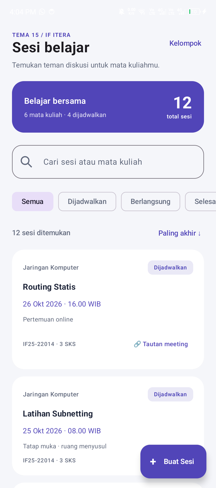
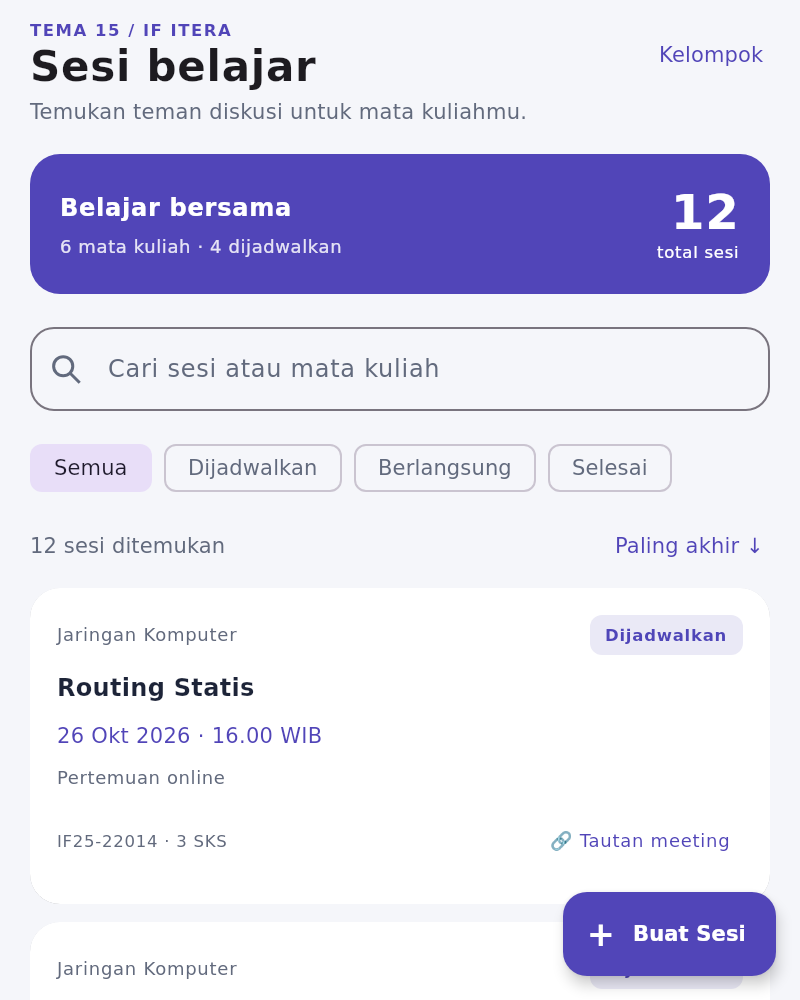
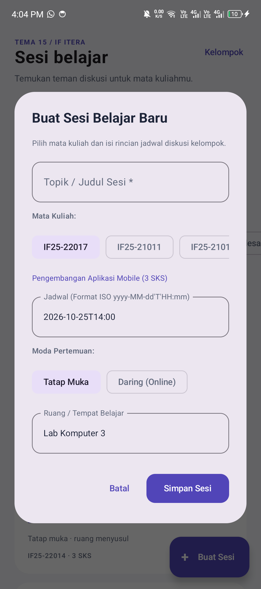
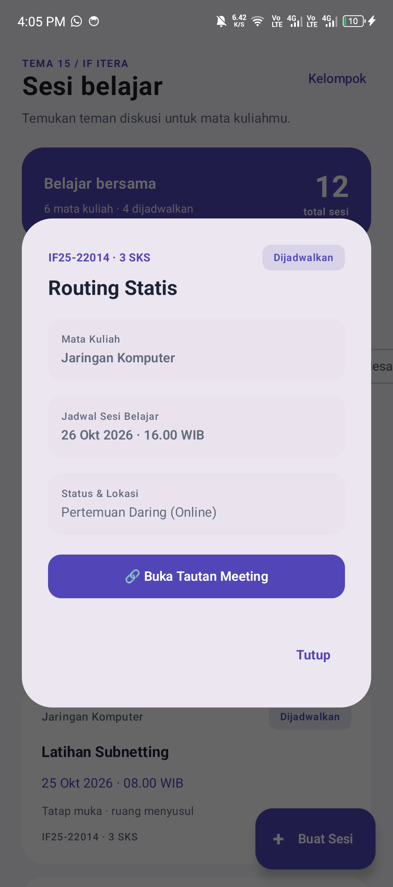

# PAM — Tema 15: Kelompok Belajar
**IF25-22017 Pengembangan Aplikasi Mobile**  
Program Studi Teknik Informatika — Institut Teknologi Sumatera (ITERA)

---

## Anggota Kelompok

| No | NIM | Nama | Peran |
|:---:|:---:|:---|:---:|
| 1 | 123140054 | Marcel Kevin Togap Siagian | Ketua Kelompok |
| 2 | 123140060 | Nadia Anatashiva | Anggota |
| 3 | 123140047 | Ray Regan Sitepu | Anggota |
| 4 | 123140179 | Ripaldy Saputra Lumbantoruan | Anggota |

---

## Informasi Proyek
- **Nomor Tema**: 15
- **Topik Tema**: Kelompok Belajar
- **Fitur Platform Terintegrasi**: Notifikasi
- **Teknologi**: Kotlin Multiplatform (KMP) & Compose Multiplatform
- **Target Platform**: Android, Desktop (JVM), iOS
- **Arsitektur Branch**:
  - `main`: *Base template* proyek KMP.
  - `Tugas<minggu>`: Branch pengerjaan checkpoint/fitur berkala sebelum di-*merge* via Pull Request (contoh: `Tugas1`, `Tugas2`, `Tugas3`).

---

## Daftar Isi
- [Dokumentasi Checkpoint 1: Setup Lingkungan & KMP](#dokumentasi-checkpoint-1-setup-lingkungan--kmp)
- [Dokumentasi Checkpoint 2: Model Data, Coroutines, dan Flow](#dokumentasi-checkpoint-2-model-data-coroutines-dan-flow)
- [Dokumentasi Checkpoint 3: Dasar Compose Multiplatform](#dokumentasi-checkpoint-3-dasar-compose-multiplatform)
- [Galeri Tangkapan Layar (Screenshots)](#galeri-tangkapan-layar-screenshots)
- [Cara Menjalankan Aplikasi](#cara-menjalankan-aplikasi)

---

## Dokumentasi Checkpoint 1: Setup Lingkungan & KMP

Pada tahap Checkpoint 1, kelompok menginisialisasi arsitektur multiplatform dasar dan menyusun tampilan awal aplikasi untuk mengenalkan identitas kelompok belajar.

1. **Setup Lingkungan & Multiplatform:**
   - Menginisialisasi proyek berbasis **Compose Multiplatform** yang dapat berjalan pada target **Android** dan **Desktop (JVM)**.
   - Menerapkan mekanisme **`expect` / `actual`** pada `Platform.kt` untuk menampilkan nama serta runtime platform aktif secara dinamis (`getPlatform().name`) pada bilah header.
2. **Identitas Tema & Anggota Kelompok:**
   - Menampilkan banner identitas **Tema 15: Kelompok Belajar** beserta deskripsinya pada header utama.
   - Menyusun kartu profil seluruh anggota kelompok (`AnggotaCard`) yang memuat Nama, NIM, avatar inisial dinamis, dan penanda peran (Ketua/Anggota).
3. **Interaktivitas State & Animasi:**
   - Menggunakan state lokal Compose (`remember { mutableStateOf(false) }`) untuk tombol interaktif *toggle* buka-tutup informasi jadwal belajar.
   - Memanfaatkan komponen **`AnimatedVisibility`** untuk memberikan efek transisi kemunculan jadwal belajar yang halus dan responsif.

---

## Dokumentasi Checkpoint 2: Model Data, Coroutines, dan Flow

Pada tahap Checkpoint 2, kelompok mengembangkan model data, simulasi sumber data asinkron, serta pemantauan status sesi untuk Tema 15: Kelompok Belajar menggunakan Kotlin Coroutines dan Flow.

1. **Model Data & Status Sesi Belajar:**
   - Membuat data class [`MataKuliah`](shared/src/commonMain/kotlin/com/example/myfirstkmpapp/model/MataKuliah.kt) (kode, nama, SKS) serta [`SesiBelajar`](shared/src/commonMain/kotlin/com/example/myfirstkmpapp/model/SesiBelajar.kt) (ID, judul, mata kuliah, waktu mulai, tautan meeting nullable, dan status).
   - Menggunakan sealed class [`StatusSesiBelajar`](shared/src/commonMain/kotlin/com/example/myfirstkmpapp/model/StatusSesiBelajar.kt) untuk tiga kondisi: `Dijadwalkan`, `Berlangsung(ruang)`, dan `Selesai(catatan)`; disertai fungsi `ringkas()` dan `label()`.
2. **Implementasi Coroutines & Flow:**
   - Mendefinisikan interface generik [`Sumber<T>`](shared/src/commonMain/kotlin/com/example/myfirstkmpapp/data/Sumber.kt) dengan `suspend fun ambil(id: Int): T` dan `fun pantau(id: Int): Flow<T>` sebagai kontrak akses data.
   - Membuat [`SumberSesiBelajarDummy`](shared/src/commonMain/kotlin/com/example/myfirstkmpapp/data/SumberSesiBelajarDummy.kt) berisi tiga sesi contoh. Fungsi `ambil()` memakai `delay(1000)` untuk mensimulasikan pengambilan data secara asinkron.
   - Menerapkan `flow`, `emit`, `delay`, dan `copy()` pada `pantau(id)` untuk mengirim perubahan status `Dijadwalkan` → `Berlangsung` → `Selesai` secara berurutan.
3. **Pengujian Runner Konsol & Log Bukti:**
   - Membuat [`runner/Main.kt`](shared/src/commonMain/kotlin/com/example/myfirstkmpapp/runner/Main.kt) dengan `runBlocking` untuk memanggil `ambil(1)`, lalu `collect` pada `pantau(1)` dan mencetak pembaruan status sesi ke konsol.
   - Terbukti berhasil dieksekusi dengan keluaran teks konsol:
     ```text
     Mengambil data sesi belajar...
     Judul: Belajar Bareng Coroutines & Flow KMP
     Mata Kuliah: Pengembangan Aplikasi Mobile
     Status awal: Dijadwalkan

     Sebelum collect flow
     Status berubah: Dijadwalkan
     Status berubah: Berlangsung(ruang=Lab Komputer 3 / Google Meet)
     Status berubah: Selesai(catatan=Materi Coroutines dan Flow selesai didiskusikan)
     Sesudah collect flow
     ```
   - Tangkapan layar bukti eksekusi runner melalui Gradle (`hotRunJvm`):
     <br>
     

### Rangkuman Komponen Checkpoint 2

| Komponen | Berkas Implementasi | Deskripsi / Peran |
|:---|:---|:---|
| Entitas Utama | [`model/SesiBelajar.kt`](shared/src/commonMain/kotlin/com/example/myfirstkmpapp/model/SesiBelajar.kt) | `data class` menyimpan ID, judul, mata kuliah, waktu mulai, tautan meeting nullable, dan status sesi. |
| Entitas Pendukung | [`model/MataKuliah.kt`](shared/src/commonMain/kotlin/com/example/myfirstkmpapp/model/MataKuliah.kt) | `data class` menyimpan kode mata kuliah, nama, dan SKS. |
| Status Sesi Belajar | [`model/StatusSesiBelajar.kt`](shared/src/commonMain/kotlin/com/example/myfirstkmpapp/model/StatusSesiBelajar.kt) | `sealed class` untuk 3 status: `Dijadwalkan`, `Berlangsung(ruang)`, dan `Selesai(catatan)`. |
| Kontrak Sumber Data | [`data/Sumber.kt`](shared/src/commonMain/kotlin/com/example/myfirstkmpapp/data/Sumber.kt) | `interface` generik dengan `suspend fun ambil(id: Int): T` dan `fun pantau(id: Int): Flow<T>`. |
| Sumber Data Dummy | [`data/SumberSesiBelajarDummy.kt`](shared/src/commonMain/kotlin/com/example/myfirstkmpapp/data/SumberSesiBelajarDummy.kt) | Implementasi `Sumber<SesiBelajar>` dengan `delay(1000)` dan aliran `Flow` status berurutan via `emit()`. |
| Runner Konsol | [`runner/Main.kt`](shared/src/commonMain/kotlin/com/example/myfirstkmpapp/runner/Main.kt) | Eksekutor `runBlocking` untuk memanggil `ambil(1)` dan mengoleksi `pantau(1)`. |

### Pembagian Tugas Checkpoint 2
Urutan pengerjaan: **Marcel (Model) → Nadia (Data Source) → Ripaldy (Runner) → Ray (README)**.

| Urutan | Nama | NIM | Fokus | Tugas Checkpoint 2 |
|:---:|:---|:---:|:---|:---|
| 1 | Marcel Kevin Togap Siagian | 123140054 | Model | Menyiapkan `SesiBelajar`, `MataKuliah`, dan `StatusSesiBelajar`, termasuk tipe nullable dan extension function model. |
| 2 | Nadia Anatashiva | 123140060 | Data Source | Menyiapkan kontrak `Sumber<T>` dan `SumberSesiBelajarDummy` dengan fungsi `suspend`, `delay`, serta Flow perubahan status. |
| 3 | Ripaldy Saputra Lumbantoruan | 123140179 | Runner | Menyiapkan `runner/Main.kt` untuk menjalankan pengambilan sesi dan mencetak perubahan status dari Flow. |
| 4 | Ray Regan Sitepu | 123140047 | Dokumentasi README | Menulis rangkuman Checkpoint 2, memasukkan log keluaran konsol hasil eksekusi runner, serta mencantumkan tabel pembagian tugas. |

---

## Dokumentasi Checkpoint 3: Dasar Compose Multiplatform

Pada tahap Checkpoint 3, kelompok mengembangkan antarmuka pengguna Layar Pertama (Layar Sesi Belajar) untuk Tema 15: Kelompok Belajar menggunakan Compose Multiplatform pada target Android dan Desktop (JVM).

1. **Komponen Kartu & Badge Status Visual:**
   - Membuat komponen modular [`KartuSesiBelajar.kt`](shared/src/commonMain/kotlin/com/example/myfirstkmpapp/ui/KartuSesiBelajar.kt) menggunakan `Card`, `Row`, `Column`, serta `Modifier` untuk menyajikan mata kuliah, judul topik, jadwal waktu, dan lokasi secara terstruktur.
   - Mengembangkan composable `LabelStatusSesi` dengan badge warna adaptif untuk membedakan status `Dijadwalkan`, `Berlangsung`, dan `Selesai` secara konsisten lintas platform di `commonMain`.
2. **Layar Daftar, Koleksi Data & Aksi FAB:**
   - Menyiapkan 12 dataset contoh sesi belajar di [`DataContohSesi.kt`](shared/src/commonMain/kotlin/com/example/myfirstkmpapp/data/DataContohSesi.kt) beserta fungsi pembantu koleksi: `cariSesi`, `filterBerdasarkanStatus`, dan `urutkanBerdasarkanWaktu`.
   - Menyusun [`LayarSesiBelajar.kt`](shared/src/commonMain/kotlin/com/example/myfirstkmpapp/ui/LayarSesiBelajar.kt) berbasis `Scaffold` yang dilengkapi bilah pencarian (*search bar*), deretan `FilterChip` status, tombol *toggle sort*, serta `LazyColumn` dengan parameter `key` untuk performa render daftar yang efisien.
   - Menambahkan tombol *Extended Floating Action Button* (`+ Buat Sesi`) pada `Scaffold` yang memunculkan pop-up formulir interaktif [`DialogTambahSesi.kt`](shared/src/commonMain/kotlin/com/example/myfirstkmpapp/ui/DialogTambahSesi.kt) untuk input sesi baru.
3. **Interaktivitas Detail Sesi, Pengujian Unit & Dokumentasi:**
   - Mengintegrasikan aksi klik kartu ke dialog pop-up [`DialogDetailSesi.kt`](shared/src/commonMain/kotlin/com/example/myfirstkmpapp/ui/DialogDetailSesi.kt) untuk melihat rincian lengkap sesi dan membuka tautan pertemuan (*meeting link*) secara langsung via `LocalUriHandler`.
   - Menulis 8 kasus pengujian unit JVM pada [`DataContohSesiTest.kt`](shared/src/commonTest/kotlin/com/example/myfirstkmpapp/DataContohSesiTest.kt) guna memastikan kebenaran fungsi pencarian, penyaringan status, pengurutan waktu, dan penambahan data.
   - Mengambil tangkapan layar langsung pada target Android dan Desktop (JVM Compose), lalu menatanya berdampingan pada dokumentasi.

### Rangkuman Komponen Checkpoint 3

| Komponen | Berkas Implementasi | Deskripsi / Peran |
|:---|:---|:---|
| Dataset & Koleksi | [`data/DataContohSesi.kt`](shared/src/commonMain/kotlin/com/example/myfirstkmpapp/data/DataContohSesi.kt) | 12 dataset contoh sesi belajar dan fungsi koleksi: `urutkanBerdasarkanWaktu`, `filterBerdasarkanStatus`, `cariSesi`. |
| Komponen Kartu & Status | [`ui/KartuSesiBelajar.kt`](shared/src/commonMain/kotlin/com/example/myfirstkmpapp/ui/KartuSesiBelajar.kt) | Composable `KartuSesiBelajar` dengan tata letak modular dan badge status visual `LabelStatusSesi`. |
| Layar Utama Daftar | [`ui/LayarSesiBelajar.kt`](shared/src/commonMain/kotlin/com/example/myfirstkmpapp/ui/LayarSesiBelajar.kt) | Layar berbasis `Scaffold`, `LazyColumn` dengan `key`, bilah pencarian, dan filter status. |
| Formulir Tambah (FAB) | [`ui/DialogTambahSesi.kt`](shared/src/commonMain/kotlin/com/example/myfirstkmpapp/ui/DialogTambahSesi.kt) | Extended Floating Action Button dan pop-up formulir interaktif tambah sesi belajar. |
| Rincian Detail Sesi | [`ui/DialogDetailSesi.kt`](shared/src/commonMain/kotlin/com/example/myfirstkmpapp/ui/DialogDetailSesi.kt) | Dialog pop-up rincian kartu sesi belajar dan pembuka tautan pertemuan (*meeting link*). |
| Pengujian Unit | [`commonTest/.../DataContohSesiTest.kt`](shared/src/commonTest/kotlin/com/example/myfirstkmpapp/DataContohSesiTest.kt) | 8 test case pengujian unit JVM untuk memverifikasi keandalan data dan fungsi logika. |

### Pembagian Tugas Checkpoint 3
Urutan pengerjaan: **Ray (Dataset & Layar Daftar) → Ripaldy (Komponen Kartu) → Nadia (Aksi FAB & Formulir Tambah) → Marcel (Interaktivitas Detail, Validasi & README)**.

| Urutan | Nama | NIM | Fokus | Kontribusi Checkpoint 3 |
|:---:|:---|:---:|:---|:---|
| 1 | Ray Regan Sitepu | 123140047 | Dataset & Layar Utama | Menyiapkan dataset 12 sesi belajar & fungsi koleksi (`DataContohSesi.kt`), struktur awal layar daftar (`LazyColumn`), search bar, filter status, unit test awal, serta screenshot Android. |
| 2 | Ripaldy Saputra Lumbantoruan | 123140179 | Komponen Kartu & Status | Memisahkan dan merancang komponen modular [`KartuSesiBelajar.kt`](shared/src/commonMain/kotlin/com/example/myfirstkmpapp/ui/KartuSesiBelajar.kt), badge status visual `LabelStatusSesi`, format waktu lokal, dan styling elevasi kartu. |
| 3 | Nadia Anatashiva | 123140060 | Aksi FAB & Formulir Tambah | Menambahkan tombol *Extended Floating Action Button* (FAB) pada `Scaffold`, serta membuat dialog formulir interaktif [`DialogTambahSesi.kt`](shared/src/commonMain/kotlin/com/example/myfirstkmpapp/ui/DialogTambahSesi.kt) saat tombol tambah diklik. |
| 4 | Marcel Kevin Togap Siagian | 123140054 | Interaktivitas Kartu, Validasi & README | Mengintegrasikan aksi klik kartu ke dialog detail [`DialogDetailSesi.kt`](shared/src/commonMain/kotlin/com/example/myfirstkmpapp/ui/DialogDetailSesi.kt), memvalidasi kompilasi lintas platform, dan menyusun dokumentasi Checkpoint 3 di [README.md](README.md). |

---

## Galeri Tangkapan Layar (Screenshots)

### 1. Checkpoint 1 — Tampilan Awal Aplikasi (Android & Desktop)

| Target Android | Target Desktop (JVM) |
|:---:|:---:|
|  |  |
| *Tampilan awal template aplikasi pada Android* | *Tampilan awal template aplikasi pada Desktop (JVM)* |

### 2. Checkpoint 2 — Bukti Eksekusi Runner Terminal

| Terminal Eksekusi Runner (Gradle hotRunJvm) |
|:---:|
|  |
| *Tangkapan layar eksekusi runner konsol Coroutines & Flow memverifikasi perubahan status sesi belajar* |

### 3. Checkpoint 3 — Layar Sesi Belajar & Fitur Interaktif

| Layar Utama (Android) | Layar Utama (Desktop JVM) |
|:---:|:---:|
|  |  |
| *Daftar sesi belajar dengan pencarian, filter status, sort waktu, badge status, dan FAB (+ Buat Sesi)* | *Tampilan responsif pada Desktop JVM menggunakan kode UI Compose Multiplatform yang sama* |
| **Formulir Tambah Sesi (Dialog)** | **Rincian Detail Sesi (Dialog)** |
|  |  |
| *Dialog formulir interaktif `DialogTambahSesi` saat menekan tombol `+ Buat Sesi` (FAB)* | *Dialog detail `DialogDetailSesi` yang muncul saat kartu sesi diklik pada daftar* |

---

## Cara Menjalankan Aplikasi

Pastikan lingkungan pengembangan Anda memenuhi spesifikasi berikut:
- **JDK 17 atau JDK 21** terpasang dan tervalidasi pada variabel lingkungan `JAVA_HOME`.
- **Android Studio** (disarankan Ladybug / Jellyfish) dengan plugin **Kotlin Multiplatform Mobile**.
- **Android SDK** terpasang dengan `compileSdk = 36` dan `minSdk = 24`.

### 1. Menjalankan di Desktop (JVM)
Metode tercepat dan paling ringan untuk pengujian kode antarmuka tanpa perlu menyalakan emulator:
```bash
./gradlew :desktopApp:run
```

### 2. Menjalankan di Android
* **Melalui Android Studio:**
  1. Buka proyek di Android Studio dan tunggu proses sinkronisasi Gradle selesai.
  2. Pada bilah konfigurasi *run*, pilih target **`androidApp`**.
  3. Pilih emulator Android atau hubungkan perangkat fisik Android melalui kabel USB dengan mode *USB Debugging* aktif.
  4. Klik tombol **Run**.
* **Melalui Terminal (CLI):**
  ```bash
  # Pasang aplikasi ke perangkat / emulator yang aktif
  ./gradlew :androidApp:installDebug

  # Buka aplikasi secara langsung lewat ADB
  adb shell am start -n com.example.myfirstkmpapp/com.example.myfirstkmpapp.MainActivity
  ```

### 3. Menjalankan Pengujian Unit (Unit Tests)
Proyek dilengkapi dengan 8 kasus pengujian unit JVM di modul shared untuk memastikan keandalan logika koleksi data:
```bash
# Menjalankan unit test khusus modul shared
./gradlew :shared:jvmTest

# Menjalankan verifikasi lengkap (unit test, linting, dan build check seluruh modul)
./gradlew check
```

### 4. Menjalankan Runner Konsol (Checkpoint 2)
Untuk memverifikasi simulasi pengambilan data asinkron dan aliran `Flow` pada Checkpoint 2:
```bash
./gradlew :shared:hotRunJvm "-PmainClass=com.example.myfirstkmpapp.runner.MainKt"
```
